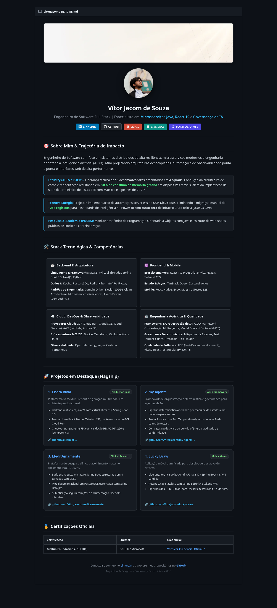

# Mockup Living Spec: [Nome da Tela / Componente] (`<slug>`)

Template canônico de especificação viva (**Living Spec**) em 3 camadas segundo o protocolo determinístico **Figma-less Mockup-as-Code** do ecossistema `VitorJacom`.

---

## 📋 Metadados

| Campo | Valor | Descrição |
| :--- | :--- | :--- |
| **Slug** | `<slug>` | Identificador único em kebab-case da tela ou componente |
| **Status** | `Draft` \| `Approved` \| `Implemented` | Estado atual no ciclo de aprovação visual (Design Gate) |
| **Origem** | `Issue #<id>` | Referência da demanda ou épico que originou a especificação |
| **Viewport** | `1280x800` (Desktop) / `390x844` (Mobile) | Resolução de referência para captura headless via Chromium |
| **Última Atualização** | `YYYY-MM-DD` | Data da última revisão do contrato visual |

---

## 🖼️ Visual Preview

> [!NOTE]
> Captura gráfica determinística gerada via navegador headless (`chromium --headless --no-sandbox --screenshot=docs/assets/mockups/<slug>.png --window-size=1280,1024 .mockup-preview.html`).



---

## 📐 Camada 1: Spatial Blueprint (ASCII)

Wireframe estrutural delimitando zonas espaciais, grid de múltiplos de 8px, proporções relativas e hierarquia de leitura:

```text
┌────────────────────────────────────────────────────────────────────────┐
│ Header / Navigation Bar (height: 64px, padding: 0 24px)                │
├────────────────────────────────────────────────────────────────────────┤
│ ┌────────────────────────────────────────────────────────────────────┐ │
│ │ Hero / Primary Content Zone (max-width: 1200px, gap: 24px)         │ │
│ │ [Headline H1]                                                      │ │
│ │ [Lead Paragraph / Value Proposition]                               │ │
│ │ [Primary CTA Button]  [Secondary Action Link]                      │ │
│ └────────────────────────────────────────────────────────────────────┘ │
├────────────────────────────────────────────────────────────────────────┤
│ ┌──────────────────────────────────┐ ┌───────────────────────────────┐ │
│ │ Feature Card A (col-span-6)      │ │ Feature Card B (col-span-6)   │ │
│ │ • Metric / Highlight             │ │ • Metric / Highlight          │ │
│ └──────────────────────────────────┘ └───────────────────────────────┘ │
├────────────────────────────────────────────────────────────────────────┤
│ Footer / Status & Metadata Bar                                         │
└────────────────────────────────────────────────────────────────────────┘
```

---

## 🎨 Camada 2: Design Tokens & Luminance Contract

### 1. Paleta de Cores & Contrato de Luminância (Value Contrast & WCAG)

| Token | Hex | Luminância Relativa ($L$) | Aplicação | Value Contrast (Mono) | WCAG AA Legibilidade |
| :--- | :--- | :--- | :--- | :--- | :--- |
| `--surface-canvas` | `#0d1117` | $L \approx 4.8\%$ | Fundo principal da aplicação | Base de referência | - |
| `--surface-card` | `#161b22` | $L \approx 8.9\%$ | Superfície elevada de cartões | $1.85:1$ + Borda ativa | Ancoragem por oclusão |
| `--surface-border` | `#30363d` | $L \approx 21.6\%$ | Delimitação estrutural de containers | **$4.5:1$** vs Canvas | Separação tátil nítida |
| `--text-primary` | `#f0f6fc` | $L \approx 95.8\%$ | Títulos e texto principal | - | **$19.9:1$** (Pass AAA) |
| `--text-secondary` | `#8b949e` | $L \approx 59.8\%$ | Subtítulos, legendas e metadados | - | **$12.4:1$** (Pass AAA) |
| `--accent-primary` | `#38bdf8` | $L \approx 72.8\%$ | Ações primárias, foco e destaques | - | **$15.1:1$** (Pass AAA) |

### 2. Escala Tipográfica & Espaçamento

| Escala | Tamanho / Line-Height | Peso | Aplicação |
| :--- | :--- | :--- | :--- |
| **Display H1** | `28px` / `36px` | Bold (`700`) | Título principal da visualização |
| **Section H2** | `20px` / `28px` | Semi-Bold (`600`) | Cabeçalhos de seções estruturais |
| **Card Title H3** | `16px` / `24px` | Semi-Bold (`600`) | Títulos de cartões e módulos |
| **Body Regular** | `14px` / `22px` | Regular (`400`) | Conteúdo textual corrido |
| **Caption / Code** | `12px` / `16px` | Medium (`500`) | Badges, tags técnicas e atalhos |

---

## ⚡ Estados Interativos, Microinterações & Acessibilidade

1. **Estados de Foco e Teclado (`:focus-visible`)**:
   - Todo elemento interativo deve apresentar anel de foco visível (`2px solid #38bdf8`, `outline-offset: 2px`) para navegação assistiva via `Tab`.
2. **Estados de Hover & Active (`:hover`, `:active`)**:
   - Transições suaves de `150ms cubic-bezier(0.22, 1, 0.36, 1)` elevando a borda do cartão de `#30363d` para `#38bdf8` sem causar deslocamento de layout (*Zero Layout Shift*).
3. **Respeito a `prefers-reduced-motion`**:
   - Animações decorativas são desativadas automaticamente quando o sistema operacional solicita redução de movimento.
4. **Checklist do Visual Gate**:
   - [x] Contraste de valor monocromático $\ge 2:1$ ou delimitação explícita por borda de oclusão.
   - [x] Contraste tipográfico WCAG AA $\ge 4.5:1$ para texto normal e $\ge 3.0:1$ para texto grande.
   - [x] Captura determinística persistida em `docs/assets/mockups/<slug>.png`.
