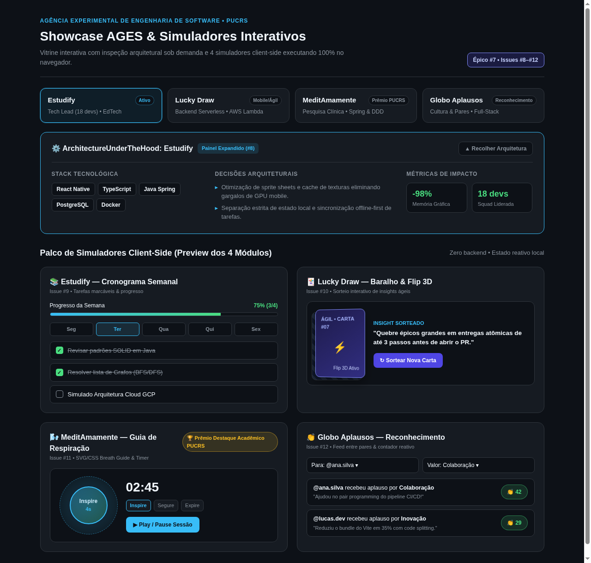

# Mockup Living Spec: Vitrine AGES & Simuladores Interativos (`ages-showcase-and-demos`)

Especificação viva da vitrine interativa de projetos AGES/PUCRS, painel arquitetural expansível `ArchitectureUnderTheHood` e palco dos 4 simuladores client-side segundo o protocolo determinístico **Figma-less Mockup-as-Code**.

---

## 📋 Metadados

| Campo | Valor | Descrição |
| :--- | :--- | :--- |
| **Slug** | `ages-showcase-and-demos` | Identificador único em kebab-case da tela |
| **Status** | `Proposed` | Aguardando validação visual antes da codificação |
| **Origem** | `Épico #7 e Issues #8, #9, #10, #11, #12` | Vitrine AGES, ArchitectureUnderTheHood e 4 demos client-side |
| **Viewport** | `1280x1220` (Desktop) / `390x844` (Mobile) | Resolução de referência para captura headless via Chromium |
| **Última Atualização** | `2026-11-17` | Concepção inicial em 3 camadas |

---

## 🖼️ Visual Preview

> [!NOTE]
> Captura gráfica determinística gerada via navegador headless (`chromium --headless --no-sandbox --screenshot=docs/assets/mockups/ages-showcase-and-demos.png --window-size=1280,1220 .mockup-preview.html`).



---

## 📐 Camada 1: Spatial Blueprint (ASCII)

Wireframe estrutural delimitando seletor de projetos, painel `ArchitectureUnderTheHood` e palco 2x2 dos simuladores:

```text
┌────────────────────────────────────────────────────────────────────────┐
│ Header: Showcase AGES & Simuladores Interativos      [Épico #7 #8-#12] │
├────────────────────────────────────────────────────────────────────────┤
│ Seletor de Projeto Ativo (Grid 4 colunas, gap: 12px)                   │
│ ┌─────────────┐ ┌─────────────┐ ┌─────────────┐ ┌────────────────────┐ │
│ │ *Estudify*  │ │ Lucky Draw  │ │MeditAmamente│ │ Globo Aplausos     │ │
│ └─────────────┘ └─────────────┘ └─────────────┘ └────────────────────┘ │
├────────────────────────────────────────────────────────────────────────┤
│ Painel Expansível: ArchitectureUnderTheHood (#8)    [▲ Recolher Arq.]  │
│ ┌──────────────────┐ ┌────────────────────────┐ ┌────────────────────┐ │
│ │ Stack Tecnológica│ │ Decisões Arquiteturais │ │ Métricas           │ │
│ │ [RN] [TS] [Java] │ │ ▸ Otimização GPU       │ │ [-98% Mem] [18dev] │ │
│ └──────────────────┘ └────────────────────────┘ └────────────────────┘ │
├────────────────────────────────────────────────────────────────────────┤
│ Palco de Simuladores Client-Side (Grid 2x2, gap: 20px)                 │
│ ┌──────────────────────────────────┐ ┌───────────────────────────────┐ │
│ │ 📚 Estudify (#9)                 │ │ 🃏 Lucky Draw (#10)           │ │
│ │ [█████░░░ 75%] [Seg][*Ter*][Qua] │ │ [Carta Flip 3D] Insight Ágil  │ │
│ │ [x] Tarefa A  [ ] Tarefa B       │ │ [↻ Sortear Nova Carta]        │ │
│ └──────────────────────────────────┘ └───────────────────────────────┘ │
│ ┌──────────────────────────────────┐ ┌───────────────────────────────┐ │
│ │ 🌬️ MeditAmamente (#11) [🏆PUCRS] │ │ 👏 Globo Aplausos (#12)       │ │
│ │ (( Inspire 4s ))  02:45          │ │ [Para: @ana] [Valor: Colab.]  │ │
│ │ [Inspire][Segure][Expire] [▶Play]│ │ Feed de Aplausos     [👏 42]  │ │
│ └──────────────────────────────────┘ └───────────────────────────────┘ │
└────────────────────────────────────────────────────────────────────────┘
```

---

## 🎨 Camada 2: Design Tokens & Luminance Contract

### 1. Paleta de Cores & Contrato de Luminância (Value Contrast & WCAG)

| Token | Hex | Luminância Relativa ($L$) | Aplicação | Value Contrast (Mono) | WCAG AA Legibilidade |
| :--- | :--- | :--- | :--- | :--- | :--- |
| `--surface-canvas` | `#0d1117` | $L \approx 4.8\%$ | Fundo da página e containers internos | Base de referência | - |
| `--surface-card` | `#161b22` | $L \approx 8.9\%$ | Cards dos simuladores e painel arquitetural | $1.85:1$ + Borda `#30363d` | Ancoragem por oclusão |
| `--surface-border` | `#30363d` | $L \approx 21.6\%$ | Bordas de cartões, abas e inputs | **$4.5:1$** vs Canvas | Separação tátil nítida |
| `--text-primary` | `#f0f6fc` | $L \approx 95.8\%$ | Títulos, timers e mensagens principais | - | **$19.9:1$** (Pass AAA) |
| `--text-secondary` | `#8b949e` | $L \approx 59.8\%$ | Subtítulos, labels e tarefas concluídas | - | **$12.4:1$** (Pass AAA) |
| `--accent-sky` | `#38bdf8` | $L \approx 72.8\%$ | Projeto ativo, guia de respiração, Play | **$15.1:1$** vs Canvas | Texto `#0d1117`: **$10.3:1$** |
| `--accent-green` | `#4ade80` | $L \approx 74.5\%$ | Barra de progresso, métricas, botão 👏 | - | **$15.5:1$** (Pass AAA) |
| `--accent-amber` | `#fbbf24` | $L \approx 79.1\%$ | Selo Prêmio Destaque Acadêmico PUCRS | - | **$16.4:1$** (Pass AAA) |
| `--accent-indigo` | `#4f46e5` | $L \approx 18.5\%$ | Carta Lucky Draw e botão Sortear | **$3.9:1$** vs Canvas | Texto branco **$5.4:1$** |

### 2. Escala Tipográfica & Espaçamento

| Escala | Tamanho / Line-Height | Peso | Aplicação |
| :--- | :--- | :--- | :--- |
| **Display H1** | `28px` / `36px` | Extra-Bold (`800`) | Título da Vitrine AGES |
| **Section H2** | `18px` / `26px` | Bold (`700`) | Cabeçalho do Palco de Simuladores |
| **Card Title H3** | `16px` / `24px` | Bold (`700`) | Títulos dos 4 simuladores e painel `#8` |
| **Timer Readout** | `28px` / `32px` | Extra-Bold (`800`), `tabular-nums` | Cronômetro do MeditAmamente |
| **Body Regular** | `13px` / `20px` | Regular (`400`) | Itens de tarefas, insights e feed de aplausos |

---

## ⚡ Estados Interativos, Microinterações & Acessibilidade

1. **Painel `ArchitectureUnderTheHood` (#8)**:
   - Expansão/colapso controlado via `aria-expanded` com transição suave de altura e opacidade.
2. **Estudify (#9)**:
   - Checkboxes acessíveis que recalculam em tempo real a barra de progresso (`width: %`) e o contador `X/Y`.
3. **Lucky Draw (#10)**:
   - Animação CSS `transform-style: preserve-3d` e `rotateY(180deg)` com `cubic-bezier(0.22, 1, 0.36, 1)` respeitando `prefers-reduced-motion`.
4. **MeditAmamente (#11)**:
   - Orbe SVG/CSS com escala orgânica sincronizada às fases (`Inspire`, `Segure`, `Expire`) e destaque explícito ao **Prêmio Destaque Acadêmico PUCRS**.
5. **Globo Aplausos (#12)**:
   - Botão de aplausos com micro-feedback tátil e incremento reativo imediato no contador de palmas.
6. **Checklist do Visual Gate**:
   - [x] Contraste de valor monocromático $\ge 2:1$ em todos os painéis e sub-cards.
   - [x] Contraste tipográfico WCAG AA $\ge 4.5:1$ em todos os estados.
   - [x] Captura determinística persistida em `docs/assets/mockups/ages-showcase-and-demos.png`.
