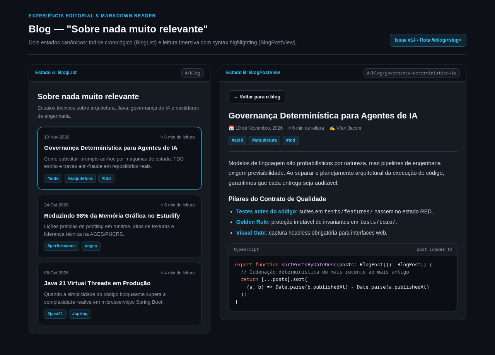

# Mockup Living Spec: Experiência Editorial do Blog (`blog-reader-experience`)

Especificação viva da experiência de leitura do blog autoral ("Sobre nada muito relevante") contemplando os estados `BlogList` e `BlogPostView` segundo o protocolo determinístico **Figma-less Mockup-as-Code**.

---

## 📋 Metadados

| Campo | Valor | Descrição |
| :--- | :--- | :--- |
| **Slug** | `blog-reader-experience` | Identificador único em kebab-case da tela |
| **Status** | `Proposed` | Aguardando validação visual antes da codificação |
| **Origem** | `Issue #14` | BlogList ordenado por data e BlogPostView em `#/blog/<slug>` |
| **Viewport** | `1280x920` (Desktop Split Preview) / `390x844` (Mobile) | Resolução de referência para captura headless via Chromium |
| **Última Atualização** | `2026-11-17` | Concepção inicial em 3 camadas |

---

## 🖼️ Visual Preview

> [!NOTE]
> Captura gráfica determinística gerada via navegador headless (`chromium --headless --no-sandbox --screenshot=docs/assets/mockups/blog-reader-experience.png --window-size=1280,920 .mockup-preview.html`).



---

## 📐 Camada 1: Spatial Blueprint (ASCII)

Wireframe estrutural apresentando os dois estados canônicos da rota do blog (`#/blog` e `#/blog/<slug>`):

```text
┌────────────────────────────────────────────────────────────────────────┐
│ Header Editorial: Blog — "Sobre nada muito relevante"     [Issue #14]  │
├──────────────────────────────────┬─────────────────────────────────────┤
│ Estado A: BlogList (#/blog)      │ Estado B: BlogPostView (#/blog/slug)│
│                                  │                                     │
│ Sobre nada muito relevante       │ [← Voltar para o blog]              │
│ Ensaios técnicos sobre arquitet. │                                     │
│                                  │ # Governança Determinística p/ IA   │
│ ┌──────────────────────────────┐ │ 📅 10 Nov 2026 • ⏱ 6 min • ✍️ Vítor │
│ │ 10 Nov 2026      ⏱ 6 min     │ │ [#aidd] [#arquitetura] [#tdd]       │
│ │ *Governança Determinística*  │ ├─────────────────────────────────────┤
│ │ Resumo executivo do artigo...│ │ Parágrafo editorial (line: 1.75)    │
│ │ [#aidd] [#arquitetura] [#tdd]│ │                                     │
│ └──────────────────────────────┘ │ Pilares do Contrato de Qualidade    │
│ ┌──────────────────────────────┐ │ • Testes antes do código            │
│ │ 24 Out 2026      ⏱ 5 min     │ │ • Golden Rule em tests/core/        │
│ │ Reduzindo 98% da Memória     │ │                                     │
│ │ [#performance] [#ages]       │ │ ┌─────────────────────────────────┐ │
│ └──────────────────────────────┘ │ │ typescript          loader.ts   │ │
│ ┌──────────────────────────────┐ │ │ export function sortPosts...    │ │
│ │ 08 Out 2026      ⏱ 4 min     │ │ └─────────────────────────────────┘ │
│ │ Java 21 Virtual Threads      │ │                                     │
│ └──────────────────────────────┘ │                                     │
└──────────────────────────────────┴─────────────────────────────────────┘
```

---

## 🎨 Camada 2: Design Tokens & Luminance Contract

### 1. Paleta de Cores & Contrato de Luminância (Value Contrast & WCAG)

| Token | Hex | Luminância Relativa ($L$) | Aplicação | Value Contrast (Mono) | WCAG AA Legibilidade |
| :--- | :--- | :--- | :--- | :--- | :--- |
| `--surface-canvas` | `#0d1117` | $L \approx 4.8\%$ | Fundo principal e cards de lista | Base de referência | - |
| `--surface-card` | `#161b22` | $L \approx 8.9\%$ | Container editorial e reader frame | $1.85:1$ + Borda `#30363d` | Ancoragem por oclusão |
| `--surface-code` | `#0b0f14` | $L \approx 3.8\%$ | Fundo de blocos de código `<pre>` | Recuo de luminância | Destaque sintático nítido |
| `--surface-border` | `#30363d` | $L \approx 21.6\%$ | Bordas de cards, divisores e code-head | **$4.5:1$** vs Canvas | Separação tátil nítida |
| `--text-primary` | `#f0f6fc` | $L \approx 95.8\%$ | Títulos de artigos e botões de retorno | - | **$19.9:1$** (Pass AAA) |
| `--text-prose` | `#d0d7de` | $L \approx 83.2\%$ | Corpo editorial de leitura longa | - | **$14.2:1$** (Conforto leitura) |
| `--text-secondary` | `#8b949e` | $L \approx 59.8\%$ | Datas, tempo de leitura e resumos | - | **$12.4:1$** (Pass AAA) |
| `--accent-sky` | `#38bdf8` | $L \approx 72.8\%$ | Card selecionado, tags e destaques | - | **$15.1:1$** (Pass AAA) |

### 2. Escala Tipográfica & Espaçamento

| Escala | Tamanho / Line-Height | Peso | Aplicação |
| :--- | :--- | :--- | :--- |
| **Article H1** | `22px` / `28px` | Extra-Bold (`800`) | Título principal no `BlogPostView` |
| **List Title H3** | `15.5px` / `22px` | Bold (`700`) | Título dos cards no `BlogList` |
| **Prose Body** | `14.5px` / `25.4px` (`1.75`) | Regular (`400`) | Texto corrido do artigo (`max-width: 68ch`) |
| **Code Block** | `12.5px` / `19px` | Regular (`400`, Mono) | Snippets formatados com cabeçalho de linguagem |
| **Tag / Meta** | `11.5px` / `16px` | Semi-Bold (`600`) | Data, tempo de leitura e `#tags` |

---

## ⚡ Estados Interativos, Microinterações & Acessibilidade

1. **Ordenação Cronológica (`BlogList`)**:
   - Artigos sempre ordenados do mais recente para o mais antigo, com card clicável por inteiro e anel de foco `:focus-visible`.
2. **Navegação por Hash (`#/blog/<slug>`)**:
   - Transição direta para `BlogPostView` com scroll restaurado para o topo e botão explícito `← Voltar para o blog`.
3. **Legibilidade Editorial**:
   - Comprimento de linha controlado (`~65–72ch`) e espaçamento vertical generoso entre parágrafos, listas e blocos de código.
4. **Checklist do Visual Gate**:
   - [x] Contraste de valor monocromático $\ge 2:1$ entre cards e canvas.
   - [x] Contraste tipográfico WCAG AA $\ge 4.5:1$ em prosa, metadados e syntax highlighting.
   - [x] Captura determinística persistida em `docs/assets/mockups/blog-reader-experience.png`.
