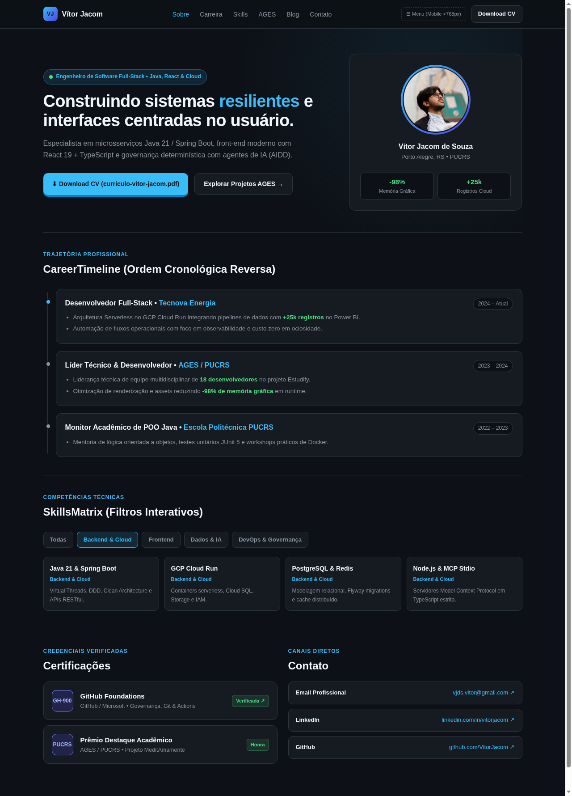

# Mockup Living Spec: Portfólio Web & Landing Page (`portfolio-landing-page`)

Especificação viva da página principal do portfólio web (`site/`) segundo o protocolo determinístico **Figma-less Mockup-as-Code** conduzido pelo subagente `uiux-designer`.

---

## 📋 Metadados

| Campo | Valor | Descrição |
| :--- | :--- | :--- |
| **Slug** | `portfolio-landing-page` | Identificador único em kebab-case da tela |
| **Status** | `Proposed` | Aguardando validação visual antes da codificação |
| **Origem** | `Issues #4, #5, #6` | Navbar, Hero, CareerTimeline, SkillsMatrix, Certifications, Contact & Footer |
| **Viewport** | `1280x1780` (Desktop) / `390x844` (Mobile) | Resolução de referência para captura headless via Chromium |
| **Última Atualização** | `2026-11-17` | Concepção inicial em 3 camadas |

---

## 🖼️ Visual Preview

> [!NOTE]
> Captura gráfica determinística gerada via navegador headless (`chromium --headless --no-sandbox --screenshot=docs/assets/mockups/portfolio-landing-page.png --window-size=1280,1780 .mockup-preview.html`).



---

## 📐 Camada 1: Spatial Blueprint (ASCII)

Wireframe estrutural delimitando zonas espaciais, grid de múltiplos de 8px, proporções relativas e hierarquia de leitura:

```text
┌────────────────────────────────────────────────────────────────────────┐
│ Sticky Navbar (h: 64px, backdrop-blur: 12px)                           │
│ [VJ] Vítor Jacom  | Sobre Carreira Skills AGES Blog Contato | [CV] [☰] │
├────────────────────────────────────────────────────────────────────────┤
│ Hero Section (max-width: 1120px, grid 1.5fr / 0.9fr, gap: 40px)        │
│ ┌────────────────────────────────────┐ ┌─────────────────────────────┐ │
│ │ [● Engenheiro Full-Stack Pill]     │ │   ┌─────────────────────┐   │ │
│ │ Construindo sistemas resilientes   │ │   │  Avatar Circular    │   │ │
│ │ e interfaces centradas no usuário. │ │   │   (156x156 px)      │   │ │
│ │ [Lead Paragraph]                   │ │   └─────────────────────┘   │ │
│ │ [⬇ Download CV] [Explorar AGES →]  │ │  [-98% Mem] [+25k Cloud]    │ │
│ └────────────────────────────────────┘ └─────────────────────────────┘ │
├────────────────────────────────────────────────────────────────────────┤
│ CareerTimeline (Ordem Cronológica Reversa, conector vertical 2px)      │
│ ● Desenvolvedor Full-Stack • Tecnova Energia             [2024 – Atual]│
│ ○ Líder Técnico & Desenvolvedor • AGES / PUCRS           [2023 – 2024] │
│ ○ Monitor Acadêmico de POO Java • PUCRS                  [2022 – 2023] │
├────────────────────────────────────────────────────────────────────────┤
│ SkillsMatrix (Filtros Interativos + Grid 4 colunas, gap: 12px)         │
│ [Todas] [*Backend & Cloud*] [Frontend] [Dados & IA] [DevOps & Gov.]    │
│ ┌──────────────┐ ┌──────────────┐ ┌──────────────┐ ┌──────────────┐    │
│ │ Java 21      │ │ GCP Cloud Run│ │ PostgreSQL   │ │ Node & MCP   │    │
│ └──────────────┘ └──────────────┘ └──────────────┘ └──────────────┘    │
├────────────────────────────────────────────────────────────────────────┤
│ ┌──────────────────────────────────┐ ┌───────────────────────────────┐ │
│ │ Certificações (col-span-6)       │ │ Contato (col-span-6)          │ │
│ │ [GH-900] GitHub Foundations      │ │ • Email: vjds.vitor@gmail.com │ │
│ │ [PUCRS]  Prêmio Destaque Acad.   │ │ • LinkedIn / GitHub           │ │
│ └──────────────────────────────────┘ └───────────────────────────────┘ │
├────────────────────────────────────────────────────────────────────────┤
│ Footer Institucional (© 2026 Vítor Jacom • React 19 + Governança AIDD) │
└────────────────────────────────────────────────────────────────────────┘
```

---

## 🎨 Camada 2: Design Tokens & Luminance Contract

### 1. Paleta de Cores & Contrato de Luminância (Value Contrast & WCAG)

| Token | Hex | Luminância Relativa ($L$) | Aplicação | Value Contrast (Mono) | WCAG AA Legibilidade |
| :--- | :--- | :--- | :--- | :--- | :--- |
| `--surface-canvas` | `#0d1117` | $L \approx 4.8\%$ | Fundo principal da página | Base de referência | - |
| `--surface-card` | `#161b22` | $L \approx 8.9\%$ | Cards da timeline, skills, contato | $1.85:1$ + Borda `#30363d` | Ancoragem por oclusão |
| `--surface-border` | `#30363d` | $L \approx 21.6\%$ | Bordas estruturais e linha da timeline | **$4.5:1$** vs Canvas | Separação tátil nítida |
| `--text-primary` | `#f0f6fc` | $L \approx 95.8\%$ | Títulos, cargos e texto principal | - | **$19.9:1$** (Pass AAA) |
| `--text-secondary` | `#8b949e` | $L \approx 59.8\%$ | Descrições, períodos e subtítulos | - | **$12.4:1$** (Pass AAA) |
| `--accent-sky` | `#38bdf8` | $L \approx 72.8\%$ | CTA primário (bg), filtro ativo, links | **$15.1:1$** vs Canvas | Texto `#0d1117` sobre Sky: **$10.3:1$** |
| `--accent-metric-green` | `#4ade80` | $L \approx 74.5\%$ | Métricas de impacto (`-98%`, `+25k`) | - | **$15.5:1$** (Pass AAA) |
| `--accent-indigo` | `#4f46e5` | $L \approx 18.5\%$ | Acento de badges e gradiente avatar | **$3.9:1$** vs Canvas | Texto claro **$5.4:1$** (Pass AA) |

### 2. Escala Tipográfica & Espaçamento

| Escala | Tamanho / Line-Height | Peso | Aplicação |
| :--- | :--- | :--- | :--- |
| **Display H1** | `38px` / `44px` | Extra-Bold (`800`) | Headline executiva no Hero |
| **Section H2** | `24px` / `32px` | Bold (`700`) | Cabeçalhos de `CareerTimeline`, `SkillsMatrix`, `Certifications`, `Contact` |
| **Card Title H3** | `16px` / `24px` | Bold (`700`) | Cargos da timeline e títulos de certificação |
| **Body Lead** | `16px` / `26px` | Regular (`400`) | Subtítulo do Hero |
| **Body Regular** | `14px` / `22px` | Regular (`400`) | Bullets técnicos e descrições de skills |
| **Caption / Badge** | `12px` / `16px` | Semi-Bold (`600`) | Kickers, períodos e pills de filtro |

---

## ⚡ Estados Interativos, Microinterações & Acessibilidade

1. **Navbar Responsiva & Mobile Drawer**:
   - Em viewports `< 768px`, os links inline são substituídos pelo botão hamburger `☰` com `aria-expanded` e drawer vertical acessível via teclado.
2. **Feedback Tátil em CTAs**:
   - Botão primário **Download CV** possui sombra inferior sólida (`0 4px 0 #0284c7`) com afundamento `translateY(2px)` no estado `:active`.
3. **Filtros Interativos (`SkillsMatrix`)**:
   - Estado ativo destacado com fundo translúcido `rgba(56, 189, 248, 0.14)`, borda `1px solid #38bdf8` e `aria-pressed="true"`.
4. **Checklist do Visual Gate**:
   - [x] Contraste de valor monocromático $\ge 2:1$ com delimitação por borda de oclusão (`#30363d`).
   - [x] Contraste tipográfico WCAG AA $\ge 4.5:1$ em todos os textos e botões.
   - [x] Captura determinística persistida em `docs/assets/mockups/portfolio-landing-page.png`.
