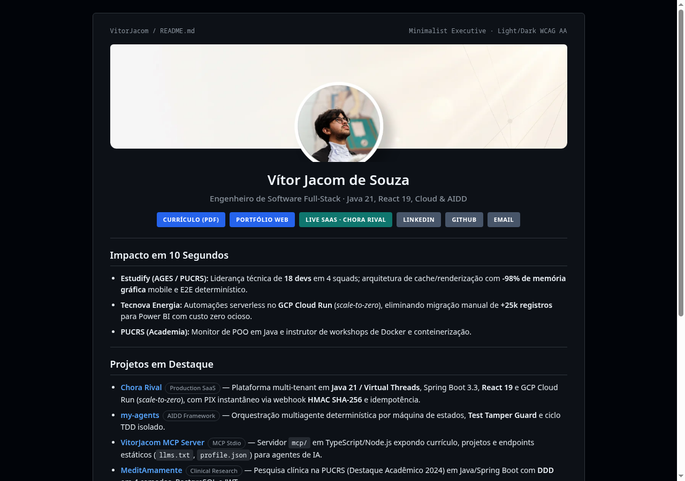

# Mockup Living Spec: Redesign Executivo do GitHub Profile README (`readme-profile`)

Especificação viva (**Living Spec**) em 3 camadas segundo o protocolo determinístico **Figma-less Mockup-as-Code** para o redesign minimalista executivo do `README.md` de perfil (`VitorJacom/VitorJacom`).

---

## 📋 Metadados

| Campo | Valor | Descrição |
| :--- | :--- | :--- |
| **Slug** | `readme-profile` | Identificador único em kebab-case da tela de perfil |
| **Status** | `Proposed` | Estado atual no ciclo de planejamento (`/plan-feature`) |
| **Origem** | Redesign `README.md` (Minimalista Executivo) | Substituição do layout com tabelas HTML 2x2 por fluxo Markdown nativo ultra-escaneável |
| **Viewport** | `1280x900` (Desktop) / `390x844` (Mobile) | Resolução de referência para captura headless via Chromium |
| **Última Atualização** | `2026-11-17` | Data de criação do contrato visual |

---

## 🖼️ Visual Preview

> [!NOTE]
> Captura gráfica determinística gerada via navegador headless (`chromium --headless --no-sandbox --screenshot=docs/assets/mockups/readme-profile.png --window-size=1280,900 .mockup-preview.html`).



---

## 📐 Camada 1: Spatial Blueprint (ASCII)

Wireframe estrutural em fluxo vertical único (Markdown nativo, sem tabelas HTML 2x2) para responsividade nativa entre Desktop e GitHub Mobile:

```text
┌────────────────────────────────────────────────────────────────────────┐
│ GitHub Profile Container (max-width: 920px, padding: 24px 32px)        │
├────────────────────────────────────────────────────────────────────────┤
│ ┌────────────────────────────────────────────────────────────────────┐ │
│ │ Hero Zone (text-align: center, gap: 14px)                          │ │
│ │ [ site/public/readme-hero.webp — Banner + Avatar Circular ]        │ │
│ │ H1: Vítor Jacom de Souza                                           │ │
│ │ Subtitle: Engenheiro de Software Full-Stack · Java 21, React 19... │ │
│ │ [Currículo (PDF)] [Portfólio Web] [Live SaaS] [LinkedIn] [GH] [Em] │ │
│ └────────────────────────────────────────────────────────────────────┘ │
├────────────────────────────────────────────────────────────────────────┤
│ ## Impacto em 10 Segundos (3 bullets curtos, métricas em negrito)      │
│ • Estudify (AGES/PUCRS): 18 devs · -98% memória gráfica · E2E          │
│ • Tecnova Energia: GCP Cloud Run · +25k registros · scale-to-zero      │
│ • PUCRS (Academia): Monitor POO Java · Workshops Docker                │
├────────────────────────────────────────────────────────────────────────┤
│ ## Projetos em Destaque (Lista Markdown nativa — 5 itens, 1-2 linhas)  │
│ • Chora Rival [Production SaaS] — Java 21 / VT, React 19, HMAC SHA-256 │
│ • my-agents [AIDD Framework] — Máquina de estados, Test Tamper Guard   │
│ • VitorJacom MCP Server [MCP Stdio] — mcp/, llms.txt, profile.json     │
│ • MeditAmamente [Clinical Research] — DDD 4 camadas, PostgreSQL, JWT   │
│ • Lucky Draw [Mobile Game] — Java 17, AWS Lambda, S3, PostgreSQL       │
├────────────────────────────────────────────────────────────────────────┤
│ ## Stack Principal (4 bullets inline-code por domínio)                 │
│ • Back-end & Arquitetura | Front-end & Mobile | Cloud | IA & Qualidade │
├────────────────────────────────────────────────────────────────────────┤
│ ## Certificações & Rodapé Minimalista                                  │
│ • GitHub Foundations (GH-900) — Credencial                             │
│ Footer: main.pdf · mcp/ · Governança Determinística AIDD               │
└────────────────────────────────────────────────────────────────────────┘
```

---

## 🎨 Camada 2: Design Tokens & Luminance Contract

### 1. Paleta de Cores & Contrato de Luminância (Dual Light/Dark Mode WCAG AA)

A paleta dos badges e superfícies foi calibrada para garantir **Value Contrast $\ge 2:1$** contra **ambos** os temas nativos do GitHub (`#ffffff` Light Mode e `#0d1117` Dark Mode), mantendo texto `#ffffff` nos badges com contraste **WCAG AA $\ge 4.5:1$** (eliminando tokens escuros como `#181717` que desaparecem no Dark Mode).

| Token | Hex | Luminância ($L$) | Aplicação | Contrast vs Light (`#ffffff`) | Contrast vs Dark (`#0d1117`) | WCAG AA Texto (`#ffffff`) |
| :--- | :--- | :--- | :--- | :--- | :--- | :--- |
| `--gh-light-canvas` | `#ffffff` | $100.0\%$ | Fundo GitHub Light Mode | Base | - | - |
| `--gh-dark-canvas` | `#0d1117` | $0.85\%$ | Fundo GitHub Dark Mode | - | Base | - |
| `--badge-primary` | `#2563EB` | $15.32\%$ | CTAs primários (`Currículo PDF`, `Portfólio Web`) | **$5.17:1$** | **$3.47:1$** | **$5.17:1$** (Pass AA) |
| `--badge-saas` | `#0F766E` | $14.19\%$ | Destaque de produto em produção (`Live SaaS · Chora Rival`) | **$5.47:1$** | **$3.28:1$** | **$5.47:1$** (Pass AA) |
| `--badge-neutral` | `#475569` | $8.85\%$ | Links sociais/contato (`LinkedIn`, `GitHub`, `Email`) | **$7.58:1$** | **$2.37:1$** | **$7.58:1$** (Pass AAA) |
| `--text-primary-dark` | `#f0f6fc` | $95.8\%$ | Títulos e destaques no Dark Mode | - | **$16.4:1$** | - |
| `--text-secondary-dark` | `#8b949e` | $59.8\%$ | Subtítulos e tags secundárias no Dark Mode | - | **$10.2:1$** | - |

### 2. Escala Tipográfica & Espaçamento (GitHub GFM Nativo)

| Escala | Tamanho / Line-Height | Peso | Aplicação |
| :--- | :--- | :--- | :--- |
| **Hero Title (`H1`)** | `26px` / `34px` | Semi-Bold (`600`) | Nome completo no Hero centralizado |
| **Hero Subtitle** | `15px` / `22px` | Medium (`500`) | Posicionamento executivo em 1 linha |
| **Section Title (`H2`)** | `18px` / `26px` | Semi-Bold (`600`) | Seções (`Impacto em 10 Segundos`, `Projetos`, `Stack`, `Certificações`) |
| **Body / Bullet** | `14px` / `22px` | Regular (`400`) / Bold (`600`) | Bullets curtos com palavras-chave destacadas |
| **Badge / Inline Code** | `11px–12px` / `16px` | Bold (`700`) / Mono (`500`) | CTAs Shields.io (`for-the-badge`) e tags de stack |

---

## ⚡ Estados Interativos, Responsividade & Checklist Visual

1. **Responsividade Mobile-First (Zero Tabelas HTML 2x2)**:
   - A remoção das tabelas `<table>` de 2 colunas garante que o GitHub Mobile (`390px`) renderize todas as seções em leitura linear sem compressão horizontal de colunas ou quebra de palavras.
2. **Zero Widgets Externos Frágeis**:
   - Ausência de gráficos SVG externos (`github-readme-stats`), garantindo tempo de carregamento instantâneo e resiliência contra indisponibilidade de APIs de terceiros.
3. **Checklist do Visual Gate**:
   - [x] Contraste de valor monocromático $\ge 2:1$ em **Light Mode (`#ffffff`)** e **Dark Mode (`#0d1117`)**.
   - [x] Contraste tipográfico WCAG AA $\ge 4.5:1$ em todos os badges e textos.
   - [x] Captura determinística persistida em `docs/assets/mockups/readme-profile.png`.
