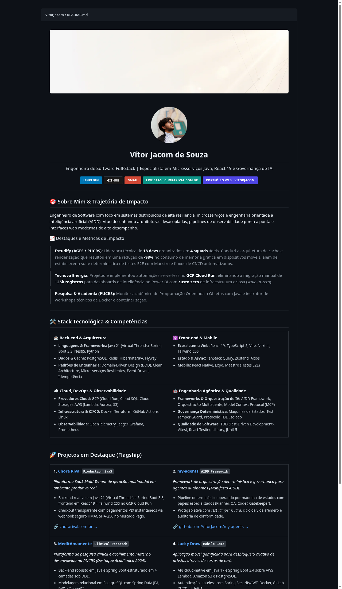

# Tela Implementada: GitHub Profile README Executivo (`github-profile-readme-live`)

Registro oficial de auditoria visual pós-implementação (**Modo 2 — Visual Gatekeeper**) do perfil público executivo do GitHub (`README.md`) implementado na **Issue #23**, com consolidação dos assets canônicos em `site/public/` e conformidade estrita com o GitHub Markdown Sanitizer.

---

## 📋 Metadados

| Campo | Valor | Descrição |
| :--- | :--- | :--- |
| **Slug** | `github-profile-readme-live` | Identificador único da tela implementada (distinto do mockup `github-profile-readme` para evitar colisão no Gollum) |
| **Status** | `Implemented (Production)` | Implementado na Issue #23 e auditado antes do merge na `main` |
| **Origem** | `Issue #23` | Consolidação de Assets de Marca & Redesign Executivo do `README.md` |
| **Living Spec de Origem** | [github-profile-readme](github-profile-readme) | Especificação viva de 3 camadas aprovada no Modo 1 |
| **Viewport de Captura** | `1280x2200` (Full-Page Dark Mode) | Renderização headless via Chromium simulando GitHub Dark Mode (`#0d1117`) |
| **Validação Automatizada** | `tests/core/profile_validation.test.mjs` & `tests/features/profile_redesign.test.mjs` | 100% verdes (incluindo budget `banner.webp <= 5KB` e zero `style=` inline em ``) |

---

## 🖼️ Captura da Implementação Renderizada

> [!NOTE]
> Evidência gráfica determinística capturada via `/usr/bin/chromium --headless` utilizando diretamente os assets finais comitados em `site/public/banner.webp` (3,526 bytes) e `site/public/avatar.png` (1:1 com canal alfa nativo).

---

## 🛠️ Assets Canônicos Consolidados (`site/public/`)

| Asset | Dimensão / Formato | Tamanho | Finalidade |
| :--- | :--- | :---: | :--- |
| `site/public/banner.webp` | Panorâmico WebP | `3.5 KB` (`3,526 B`) | Top Hero Banner no `README.md` dentro do budget `<= 5 KB` |
| `site/public/banner.jpg` | Panorâmico JPG | `14.1 KB` | Fallback de alta compatibilidade |
| `site/public/avatar.png` | `600x600` (1:1 Alfa) | `408 KB` | Avatar circular nativo no `README.md` sem CSS inline `style=` |
| `site/public/avatar.webp` | `1:1` WebP | `55 KB` | Avatar otimizado para o Portfólio Web (`site/`) |
| `site/public/favicon.svg` | Vetorial SVG | `1.4 KB` | Monograma técnico `VJ` com gradientes `v-grad` e `j-grad` |

---

## ✅ Qualidade & Governança Comprovadas

- **GitHub Sanitizer Compliance**: Zero atributos `style=` em tags `` no `README.md`.
- **Testes Core (`tests/core/profile_validation.test.mjs`)**: Integridade de headline, métricas de impacto (`18 devs`, `4 squads`, `-98%`, `+25k registros`, `custo zero`), 4 projetos flagship e links sem vazios.
- **Testes de Feature (`tests/features/profile_redesign.test.mjs`)**: Presença dos 5 assets canônicos, validação de `favicon.svg` (`v-grad` / `j-grad`) e enforcement do teto `<= 5,120 bytes` em `banner.webp`.
